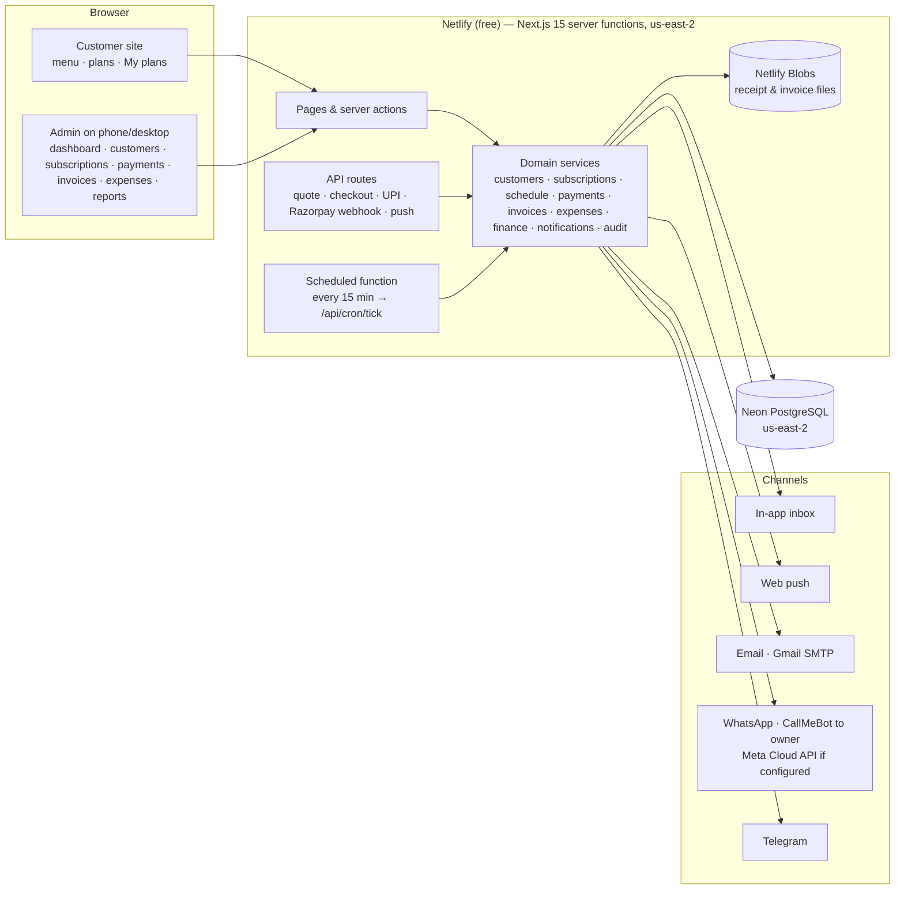
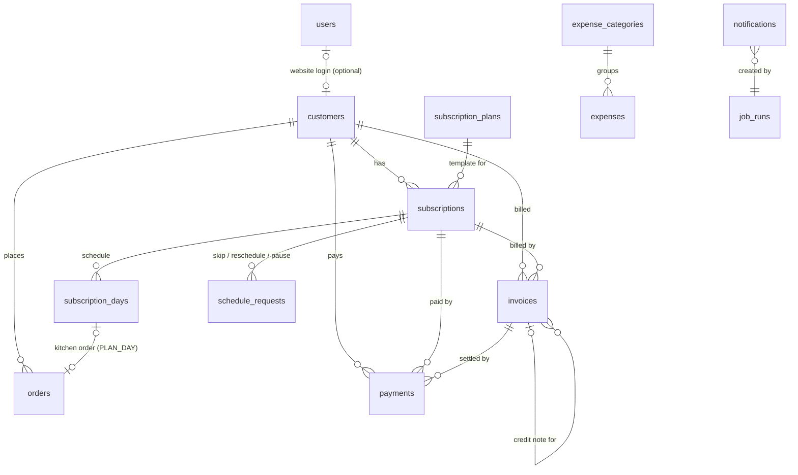
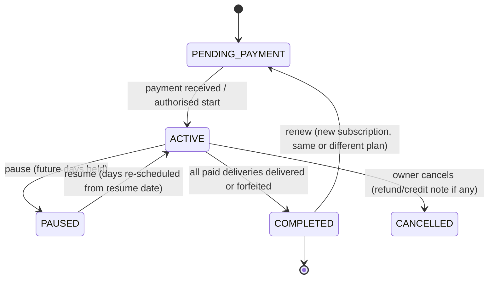

# Salad Stories: Subscriptions, Orders and Billing module (design)

This is the design for the admin module described in the brief of 22 Oct 2026. It is built **inside the existing Salad Stories app** as one system: subscriptions bought on the website and subscriptions the owner creates in the admin (for WhatsApp, phone or cash customers) share the same customers, schedules, kitchen sheet, payments, invoices and reports.

Decisions taken with the owner (22 Oct 2026):

| Topic | Decision |
|---|---|
| Website plans vs admin subscriptions | **One system** |
| Plan price | **Fixed price per plan**, with a per-day **premium surcharge** for premium bowls (and optional large-portion surcharge) |
| Delivery days | Plan default **Mon–Fri**, changeable **per customer** |
| Skips | **Owner decides each time**: reschedule to a date, carry forward to the end, or forfeit |

---

## 1. Architecture

- **Domain services** in `src/lib/biz/*` hold all rules (no business logic in pages). Every write runs in a transaction and writes an **audit log** row.
- **Money** is stored in paise (integers). **Time zone** is Asia/Kolkata everywhere (`src/lib/time.ts`).
- **Scheduled work** runs from one Netlify scheduled function every 15 minutes. Each job has a **run key** (e.g. `daily-orders:2026-10-23`) stored in `job_runs`, so a retry or a missed run never duplicates anything, and a run missed at 8 pm is caught up by the next tick.
- **Notifications** go through an **outbox** (`notifications` table). Each message has a unique dedupe key per channel, a status, attempts and the last error. Failed messages are retried automatically, and the owner can retry from the inbox.

## 2. Database schema

Existing tables (`users`, `orders`, `order_items`, `products`, `subscription_plans`, `subscriptions`, `subscription_days`, …) are extended. New tables are marked **new**.

**customers** (new): `id`, `code` (CUST-0001, auto), `name`, `phone`, `whatsapp`, `email`, `address` (json), `preferredSlotId`, `foodPreferences`, `instructions`, `manualStatus` (null | PAUSED | CANCELLED), `userId` (website account, optional), `notes`, timestamps. The display status (Trial / Active / Paused / Expired / Cancelled) is **derived** from the customer's subscriptions plus the manual status, so it can never go stale.

**subscription_plans** (extended): `price` (fixed plan price), `pricePerDay` (for "pick your days"), `premiumSurchargePerDay`, `largeSurchargePerDay`, `days`, `weekdays` (default delivery days), `isTrial`, `isActive`. **products** get `planTier` (STANDARD | PREMIUM).

**subscriptions** (extended): `customerId`, `source` (WEBSITE | ADMIN), `weekdays` (per customer), price snapshot (`subtotal`, `discount`, `tax`, `total`), `daysTotal` (paid deliveries) + `extraAuthorized`, `startDate`, `endDate` (expected completion), `actualEndDate`, `status` (PENDING_PAYMENT | ACTIVE | PAUSED | COMPLETED | CANCELLED), `renewalStatus` (NONE | DUE | RENEWED | NOT_RENEWING), `renewedFromId`, `activatedBy`, `activationNote`. **Amount paid / pending / payment status** are derived from the payments ledger, never typed in.

**subscription_days** (extended): one row per paid delivery entitlement. `date`, `originalDate`, bowl, `addressNo`, `status` (SCHEDULED | HELD | DELIVERED | FORFEITED | CANCELLED), `orderId`. Invariant enforced in code and tests: **scheduled + delivered + forfeited = paid deliveries (+ authorised extras)**. "Day 8 of 22" and "14 remaining" are computed from these rows.

**schedule_requests** (new): `subscriptionId`, `dayId`, `type` (SKIP | RESCHEDULE | PAUSE), `originalDate`, `requestedDate`, `reason`, `requestedBy` (customer/team + user), `requestedAt`, `status` (PENDING | APPROVED | REJECTED), `outcome` (RESCHEDULED | CARRIED_FORWARD | FORFEITED), `finalDate`, `decidedBy`, `decidedAt`, `endDateBefore`, `endDateAfter`, `note`.

**payments** (new, append-only ledger): `receiptNo` (RCPT-0001), `customerId`, `subscriptionId?`, `orderId?`, `invoiceId?`, `type` (PAYMENT | REFUND), `amount`, `method` (UPI | CASH | BANK | RAZORPAY | OTHER), `reference` (UTR / Razorpay ID; **unique per method**, which blocks recording the same payment twice), `status` (PENDING_VERIFICATION | RECEIVED | FAILED | REVERSED), `paidAt`, `recordedBy`, `verifiedBy`, `verifiedAt`, `note`. Amounts are never edited; a mistake is fixed with a reversal or refund row.

**invoices** (new): `number` (SS/26-27/0001, by Indian financial year), `kind` (INVOICE | CREDIT_NOTE), `relatedInvoiceId`, `customerId`, `subscriptionId?`, `orderId?`, `issueDate`, `dueDate`, `lines` (json: description, qty, rate, discount, tax rate, amount), `subtotal`, `discount`, `tax`, `total`, `status` (ISSUED | PARTIALLY_PAID | PAID | VOID), `business` (snapshot: name, address, GSTIN, phone) and `customer` (snapshot), `publicToken` (share link). Snapshots keep old invoices unchanged when prices or details change later.

**counters** (new): `key`, `value`. Gap-free sequences for customer codes, receipts and invoice numbers, incremented inside the same transaction.

**expenses** (new): `code` (EXP-0001), `date`, `categoryId`, `description`, `vendor`, `amount`, `method`, `attachmentKey` (Netlify Blobs), `notes`, `createdBy`, `deletedAt`. **expense_categories** (new): seeded with vegetables, fruits, packaging, delivery, staff, equipment, marketing/Meta ads, software, miscellaneous; the owner can add more.

**notifications** (new outbox): `kind`, `dedupeKey` (unique with channel), `channel` (IN_APP | PUSH | EMAIL | WHATSAPP | TELEGRAM), `recipient`, `title`, `body`, `link`, `status` (PENDING | SENT | DELIVERED | FAILED | READ), `deliveryConfirmed` (only true when the provider reports delivery), `attempts`, `lastError`, `providerId`, timestamps.

**job_runs** (new): `runKey` (unique), `job`, `status` (RUNNING | DONE | FAILED), `attempts`, `error`, `startedAt`, `finishedAt`.

**audit_logs** (new): `entity`, `entityId`, `action`, `before`, `after`, `reason`, `actorId`, `actorName`, `createdAt`. Written for every subscription, schedule, payment, invoice, expense and customer change.

**store_settings** (extended): legal name, address, `gstRegistered`, `gstin`, invoice prefix and terms, `dailyListTime` (default 20:00), `renewalReminderDays` (default 1), `customerMessaging` (on/off), skip policy notes.

Duplicate deliveries are blocked by a **partial unique index** on plan-day kitchen orders (customer + delivery date + slot, excluding cancelled orders), unless the owner authorises an exception.

## 3. User flows

### Customer onboarding (admin, about 1 minute)
1. **Quick action → Add customer:** name, mobile (WhatsApp defaults to the same number), address, preferred delivery time, preferences. Duplicate phone numbers are flagged.
2. **Create subscription:** pick a plan, start date and delivery weekdays (pre-filled Mon–Fri). The schedule and price are calculated automatically, and bowls default to a rotation you can change.
3. **Record payment** (UPI / cash / bank, amount, reference) or save as *pending*. The subscription **activates only when the payment is recorded as received**, or when you explicitly start it early with a reason (logged).
4. Day-by-day kitchen orders are created, an invoice is issued, and a receipt is issued for the payment.

Website customers follow the existing plan builder. Their payment (UPI verified by you, or Razorpay verified by webhook) writes the same ledger rows, invoice and receipt.

### Subscription life cycle

- Completion counts **eligible delivery days**, not calendar days: 22 deliveries means 22 rows delivered or forfeited.
- When a plan completes, no new deliveries can be added to it except authorised extras with a reason.
- The day before the final delivery, the owner gets a renewal alert and the customer gets a reminder (email; WhatsApp only through the official API, otherwise a one-tap "Send on WhatsApp" link for the owner).

### Skip, reschedule and pause
1. The customer asks on the website (up to 24 h before) or the owner logs a request from WhatsApp or a call. The day is **held** straight away, so it drops off the kitchen sheet.
2. The owner sees it in **Requests** and in the alerts, then chooses one of: **reschedule** (to a date), **carry forward** (after the last day, on a delivery weekday), **forfeit**, or **reject** (the day is restored).
3. The system records the decision, who made it, the reason, and the end date before and after. Nothing is extended or shortened silently.
4. **Pause** holds all future days. **Resume** re-schedules them from the resume date. Each held day is logged.

### Payments, invoices and receipts
- One invoice per subscription (or per order or custom bill). Each payment against it gets its own receipt.
- Partial and advance payments are supported, and the balance is always calculated from the ledger.
- Refunds create a refund ledger row and a **credit note**. Nothing is ever deleted.
- Invoices and receipts can be **printed or downloaded as PDF**, and shared by email or through a WhatsApp link with a private invoice URL.
- GST lines appear only when GST registration is switched on in Settings.

### Expenses
- **Add expense:** date (today), category, amount, method, vendor, optional photo of the bill. You can filter by date, category or vendor and export.

## 4. Notifications

| When | To whom | What | Channels |
|---|---|---|---|
| Daily at the configured time (default 8 pm) | Owner and team | **Tomorrow's orders**: customer, plan, day N of M, remaining, payment status, bowl, address, instructions | In-app, push, email, Telegram, WhatsApp (owner) |
| Same run | Owner | **Needs attention**: unpaid or partly paid, final delivery tomorrow (renewal), pending skip requests, payments to verify | Same as above |
| Day before final delivery | Owner, customer | Renewal due / reminder | Owner: all channels; customer: email, WhatsApp (official API only) |
| Plan completed | Owner | "Payment for next subscription required" | All owner channels |
| Skip request, new order, payment to verify | Owner | Instant alert | In-app, push, WhatsApp, Telegram |

- **Failures:** every send is recorded. Failed sends retry automatically up to 3 times and show a **Retry** button in the inbox.
- **WhatsApp delivery:** CallMeBot doesn't report delivery, so those messages show *Sent (delivery not confirmed)*. The Meta Cloud API delivery webhook (when configured) marks messages *Delivered*.
- **Idempotent:** the dedupe key (e.g. `daily-orders:2026-10-23:EMAIL`) means retries never send twice.

## 5. Milestones

| # | Milestone | Contents |
|---|---|---|
| **M1** | Customers, plans and payments | Schema and migrations; customers module (search, profile, history); fixed plan prices and premium tiers; create a subscription from admin; payments ledger with verification and duplicate protection; activation rules; delivery counting (day N of M); audit log |
| **M2** | Daily operations | 15-minute scheduler with job runs; 8 pm tomorrow list and attention alerts; renewal and completion jobs; notification outbox, in-app inbox and retry; skip/reschedule/pause requests (customer and admin); new dashboard with quick actions; delivery calendar |
| **M3** | Billing | Invoices and receipts (auto-numbered, snapshotted), PDF download and print, share by email/WhatsApp link, partial and advance payments, refunds and credit notes, GST settings |
| **M4** | Expenses and finance | Expenses with categories and bill photos; finance dashboard (sales vs collections, pending, advances, refunds, expenses, cash flow, operating profit estimate, subscriber metrics); CSV/Excel exports |
| **M5** | Hardening | Automated acceptance tests (the 12 scenarios in the brief), backups for new tables, mobile QA, setup, deploy and operating guide |

Each milestone is tested, deployed to the live site and recorded here before the next one starts.
