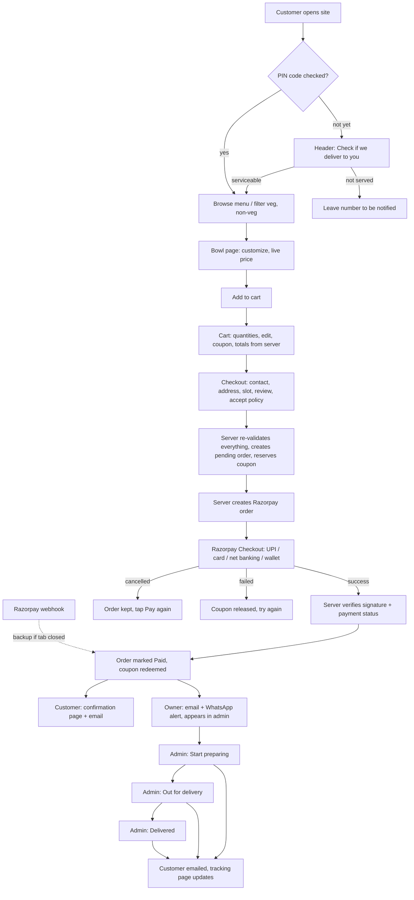

# User flows

How customers and the owner move through Salad Stories — the happy paths and what happens when something goes wrong.

## Order lifecycle (BRD §1.3 and §10.1)

## Customer flows

### 1. First visit to order (guest)
1. **Home** — hero with "Explore Our Menu" / "Order Now". On phones, the delivery bar under the header says *Check if we deliver to you*.
2. **PIN check** — enter 600113 / 600096 / 600097 → "Great — we deliver to Taramani". Any other PIN → "Sorry, Salad Stories is not delivering to this location yet." with a form to leave a phone number (owner sees these in Admin → Delivery).
3. **Menu** — five bowls with veg/non-veg symbols, price, availability; filter chips for Veg, Non-veg and categories. *Add* puts the default version in the cart; *View details* opens the customizer.
4. **Bowl page** — portion, protein, spice, dressing, extra egg (quantity), toppings (max 2), leave-out ingredients. The price on the sticky *Add to cart* button updates with every choice; required choices are highlighted if missed.
5. A toast confirms "Added to your cart" and a sticky **View cart** bar appears at the bottom of the phone screen.
6. **Cart** — change quantity, *Edit* (reopens the bowl page with the same choices), *Remove*, add a PIN for the exact delivery fee, apply a coupon. "Add ₹X more for free delivery" nudges larger orders.
7. **Checkout** (single page, numbered steps):
   1. Contact information (no account needed)
   2. Delivery address — PIN confirms the area live
   3. Delivery date and slot — only open slots can be picked; "Only 2 left" warnings
   4. Order summary
   5. Coupon code
   6. Payment method (Razorpay)
   7. Review and confirm + accept the refund policy
   8. **Place order and pay ₹…** (sticky on phones)
8. **Payment.** In Google Pay mode (current): the order page shows **Pay ₹… with Google Pay** (QR code on a computer); after paying, the customer enters the 12-digit UPI transaction ID and sees "We're checking your payment" until the owner confirms. In Razorpay mode: Razorpay Checkout opens and payment is confirmed automatically.
9. **Confirmation page** — "Thank you! Your order is confirmed", order number, slot, items, totals; email with a tracking link.
10. **Tracking page** — Confirmed → Being prepared → Out for delivery → Delivered with times; "Questions? WhatsApp us"; *Order again*.

### Install like an app
On Android (Chrome) customers can tap **⋮ → Add to Home screen**, and on iPhone (Safari) **Share → Add to Home Screen**. The site then opens full-screen from a Salad Stories icon, straight to the menu.

### 2. Returning customer with an account
- **Register / Sign in** (email + password) from the person icon. Guest cart items are merged into the account cart on sign-in, without duplicates.
- **Checkout** shows saved addresses as one-tap chips; new addresses can be saved.
- **My account** — orders with live status, *Offers you can use*, profile, saved addresses (add, edit, delete, make default), change password.
- **Order again** re-adds a past order at today's prices, skipping anything unavailable.

### 3. When something goes wrong

| Situation | What the customer sees |
|---|---|
| PIN outside delivery area | Friendly message + "Notify me" form; checkout blocked |
| Bowl sold out / disabled after adding to cart | Red note on that cart line: remove it to continue |
| Admin changed a price | "Some prices have changed…" — cart shows the new price before payment |
| Admin removed a customization choice | "Some of your choices have changed. Please edit this item." |
| Slot fills up or passes its cut-off | Slot greyed out ("Fully booked" / "Closed for today") |
| Below minimum order | "The minimum order is ₹149. Add ₹X more to check out." |
| Coupon problems | Specific message: expired, not started, minimum not met, first order only, limit reached, not for these items, not for your area |
| Double-tap on Pay / slow network | Same order is reused — never charged twice |
| Closes Razorpay window | "Payment was cancelled. Your order is saved — tap Pay again to retry." |
| Payment fails | Error shown; coupon reservation released; retry allowed |
| Pays but closes the tab before returning | Razorpay webhook still marks the order Paid and sends emails |
| Orders paused by owner | Owner's pause message shown; checkout blocked |

## Owner (admin) flows

Sign in at **/admin**. There are two kinds of team accounts (Admin → Team):

- **Admin** — everything below.
- **Staff** — dashboard, orders (move them along) and sold-out switches only. Good for kitchen and delivery helpers.

### Daily routine
0. **Check payments** (Google Pay mode): the dashboard shows "N Google Pay payments to check". Open each, find the matching amount and UPI transaction ID in your Google Pay/bank app, and tap **Payment received** (or **Not received**).
1. **Morning — Menu:** mark anything you can't make today as *Sold out* (one tap), or *Disable for now*.
2. **Delivery:** check today's slots; add a holiday if closed (Delivery → Holidays and closed days).
3. **During service — Orders → To prepare:** new paid orders arrive (also by email and Telegram/WhatsApp; the page refreshes every 30 seconds).
4. Open **Kitchen sheet** for the slot: it totals what to make (e.g. "6× Paneer Bowl — Large, No onion") and lists each order for packing. Print it or keep it on a tablet; **Start preparing all** moves every new order in that slot along at once. Or open a single order → **Start preparing** → **Mark out for delivery** → **Mark delivered**. Each step emails the customer and updates their tracking page.
5. Use **Call** / **WhatsApp** buttons on the order to reach the customer.
6. **Problems:** *Cancel order* and/or **Refund** (full or partial) — refunds go through Razorpay automatically.

### Weekly / occasional
- **Menu → Add a menu item / Edit:** name, description, price, discount price, veg/non-veg/egg, ingredients, allergens, portion, verified nutrition, photo upload, card colour, daily limit, max per order, featured, status (Draft / Published / Unavailable) and **customization options** (choose-one, choose-several, yes/no, quantity, add-on, leave-out) with extra prices, defaults, min/max.
- **Coupons:** percentage, fixed amount or free delivery; max discount, minimum order, start/end dates, total and per-customer limits, first-order only, specific items/categories/areas, campaign name; pause or delete.
- **Delivery:** add/edit/disable areas and their PIN codes, per-area fee and minimum; slots with times, cut-off, capacity and weekdays; holidays; see requests from new areas (good signal for where to expand).
- **Customers:** paying customers (guest and registered) with order count and spend; block abusive accounts.
- **Payments:** every attempt with Razorpay IDs; link to the Razorpay dashboard.
- **Reports:** download all orders as an Excel-friendly CSV for any date range; orders, revenue, average order value, discounts, revenue by day, best sellers, sales by area, coupon usage — for any date range.
- **Menu categories:** add, rename, reorder or delete (Admin → Menu, bottom of the page).
- **Team:** add staff or admins with a temporary password, change access, reset passwords.
- **Reviews:** add genuine reviews (with permission) and publish them on the home page.
- **Settings:** payment methods shown in Razorpay (UPI, cards, net banking, wallets, EMI, pay later), Telegram chat ID for free order alerts, pause ordering, same-day and advance-ordering rules, announcement bar, delivery fee, free-delivery threshold, minimum order, GST, coupon types on/off, contact details and social links, admin password.

## Behind the scenes (for a developer)

- Prices are computed in `src/lib/pricing.ts` (`quoteCart`) — used by the cart, checkout and order creation, never trusting browser values.
- Coupon rules: `src/lib/pricing-core.ts` (unit tested in `tests/`).
- Order creation, coupon reservation (serializable transaction) and idempotency: `src/lib/orders.ts`.
- Payment verification: `src/app/api/payments/verify` (signature + Razorpay fetch) and `src/app/api/webhooks/razorpay` (signature + duplicate-event guard).
- Slot capacity counts paid orders plus unpaid checkouts from the last 20 minutes, so a slot can't be oversold while customers are paying.
